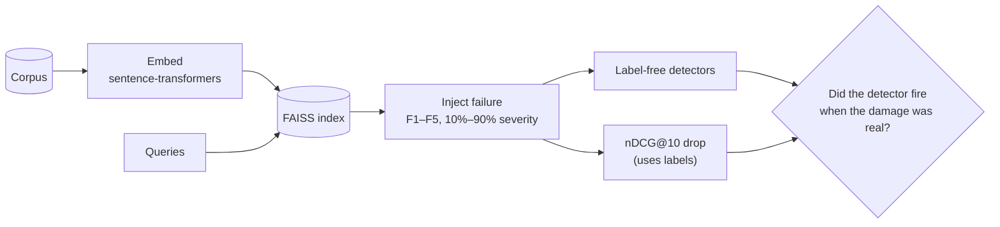

<div align="center">

# Silent Failures

**Detecting retrieval degradation in RAG systems without relevance labels**


[Motivation](#motivation) · [Approach](#approach) · [Failures](#failure-families) · [Detectors](#detectors) · [Evaluation](#evaluation) · [Results so far](#results-so-far) · [Timeline](#timeline)

</div>

## Motivation

A RAG system embeds the user's question, finds the most similar documents in a vector index, and passes them to an LLM along with the question. If the retrieval step gets worse, nothing errors out. The system stays up and latency looks normal, but the answers get worse, and usually nobody notices for a while.

A few ways this happens in practice:

- an embedding model gets upgraded, but only part of the corpus is re-embedded
- outdated documents stay in the index next to their replacements
- chunking or preprocessing settings change partway through the corpus
- users start asking about things the corpus doesn't cover

Production systems don't have relevance labels, so you can't just track nDCG. Teams rely on label-free signals instead, like drift statistics or retrieval scores. This project measures which of those signals catch real damage, and how often they fire on changes that did no harm.

**What we plan to release**

1. An open-source benchmark that injects realistic retrieval failures at controlled severity
2. A detector-by-failure heatmap showing which signal catches what, and how early
3. A short, practical guide to monitoring retrieval quality

## Approach

We build a standard retrieval pipeline, break it in controlled ways, and check whether each detector notices. The detectors only get what a production system would have: queries, embeddings and similarity scores. The labeled relevance judgments are used for one thing only, measuring how much damage each failure actually caused.



## Failure families

Each failure is applied at increasing severity: the share of the corpus or query traffic affected, from 0.1 up to 1.0.

| ID | Failure | How we simulate it | Status |
|---|---|---|---|
| F1 | Partial embedding upgrade | Mix vectors from two same-dimension models in one index | On `main` |
| F2 | Stale documents | Add off-topic distractors from ArguAna; stale content from HoH is still to do | Distractors on `main` |
| F3 | Chunking change | Re-chunk only part of the corpus, on MLDR's long documents | In review ([#82](https://github.com/Srikarmk/Silent-RAG-Failures/pull/82)) |
| F4 | Query shift | Move query traffic toward topics outside the corpus | Scoring rule open ([#13](https://github.com/Srikarmk/Silent-RAG-Failures/issues/13)) |
| F5 | Config mismatch | Drop the query prefix, turn off vector normalization, etc. | Open ([#14](https://github.com/Srikarmk/Silent-RAG-Failures/issues/14)) |

**F1** replaces a random `severity` fraction of index rows with the same documents embedded by `alt_model`. Queries stay on the clean model. `alt_model` and `alt_revision` (a lowercase 40-character commit hash) have no defaults and must be in the config, and each replacement model gets its own label. F1 rejects an `alt_model` that is the clean model (compared ignoring case, whatever the revisions). It also rejects models that need a document prefix F1 doesn't add: `intfloat/e5-*` and `intfloat/multilingual-e5-*`, whose model cards require `passage: `. Limitations: model names are compared as written, so `all-MiniLM-L6-v2` and `sentence-transformers/all-MiniLM-L6-v2` count as different. The prefix list only blocks the models it names, so an unlisted model that needs a prefix, or an e5 copy under another org, gets through. Models are added to the list only with evidence from their card, and every replacement model is pinned in a reviewed config.

We also run **negative controls**: changes that move the data around without hurting retrieval. A good detector stays quiet on these, so every alarm on one is a false alarm. There are four, from three injectors ([#76](https://github.com/Srikarmk/Silent-RAG-Failures/pull/76)):

| Control | What changes |
|---|---|
| `H_mixed_truncation` | Part of the corpus is re-embedded at 512 tokens instead of 256 |
| `H_full_swap` | Documents and queries both move to another model (all-MiniLM, bge-small). Retrieval gets better |
| `H_query_topic_shift` | A share of traffic moves to one topic cluster of the real queries |

When the queries change, each query asked is compared with its own clean result, so the topic shift does no damage by construction.

## Detectors

| Family | On `main` | Planned or in review |
|---|---|---|
| Drift statistics (ML) | KS and PSI on four per-query score features (`ks_top1`, `psi_mean10`, ...), each with a permutation-test variant (`ks_top1_perm`, ...); domain classifiers on queries and on retrieved documents | MMD ([#20](https://github.com/Srikarmk/Silent-RAG-Failures/issues/20)) |
| Query performance prediction (IR) | `qpp_max`, `qpp_gap`, `qpp_nqc` | Canary queries ([#24](https://github.com/Srikarmk/Silent-RAG-Failures/issues/24)) |
| Other | `re_embed` (re-embeds a sample of stored documents), `llm_judge` (a local model rates the top 5 for 100 queries; free to run) | `combined_scores` ([#80](https://github.com/Srikarmk/Silent-RAG-Failures/pull/80)), gated `two_stage` ([#87](https://github.com/Srikarmk/Silent-RAG-Failures/pull/87)) |

`python -m silent_rag.run --list` prints every registered detector.

We also tested, as a stretch goal, whether an agentic retriever searches more when retrieval is damaged ([#35](https://github.com/Srikarmk/Silent-RAG-Failures/issues/35)). It does, by about 0.1 searches per question, which is too small to compete with the free score detectors.

## Evaluation

The ground truth is the drop in **nDCG@10** from the clean baseline. Each check runs on a sampled window of queries, repeated over many trials per condition. A window counts as harmful when its drop is significant under a one-sided paired bootstrap test and at least 0.02 (`min_drop`, agreed in [#52](https://github.com/Srikarmk/Silent-RAG-Failures/issues/52); [#88](https://github.com/Srikarmk/Silent-RAG-Failures/pull/88) sets it in the configs, which still default to 0 until then). Thresholds come only from clean windows.

Each detector is scored on:

- **Accuracy**: AUROC for separating harmful conditions from clean and harmless ones
- **Earliness**: the lowest severity at which it fires, at a 5% false-alarm rate
- **False alarms**: how often its default threshold fires on the harmless changes
- **Cost**: compute and API cost per check

We'll also report how big an nDCG@10 drop the common "PSI > 0.25" rule of thumb actually corresponds to.

### Datasets

| Dataset | Size | Used for |
|---|---:|---|
| NFCorpus | 3,633 medical documents | Development. All detector tuning happens here |
| SciFact | 5,183 scientific abstracts | Held-out evaluation |
| FiQA | 57,638 financial forum posts | Held-out evaluation |
| MLDR | 20,000 sampled long documents | F3, which only does damage on long documents |
| ArguAna | 8,674 argument passages | Off-topic distractors for F2 |
| HoH | real outdated content | Planned source for stale documents in F2 |

SciFact and FiQA are never used for tuning, so the final numbers show how well the detectors generalize to data they haven't seen.

## Results so far

Everything below is on NFCorpus, the development set. SciFact and FiQA have only been used for the clean baseline.

**Baseline.** We kept `multi-qa-MiniLM-L6-cos-v1` and embed title + text truncated at 256 tokens, with no chunking ([#5](https://github.com/Srikarmk/Silent-RAG-Failures/issues/5)). The goal is to evaluate detectors, not to get the best retriever. Clean nDCG@10 with exact cosine search in FAISS:

| Dataset | Test queries | nDCG@10 | 95% bootstrap CI |
|---|---:|---:|---|
| NFCorpus | 323 | 0.292 | 0.259–0.325 |
| SciFact | 300 | 0.546 | 0.496–0.595 |
| FiQA | 648 | 0.360 | 0.332–0.387 |

Truncating at 256 instead of 512 tokens made no significant difference on any of the three.

**Window size.** Each check scores a window of **100 queries** ([#4](https://github.com/Srikarmk/Silent-RAG-Failures/issues/4)). On NFCorpus, that's enough for the paired bootstrap to catch an nDCG@10 drop of about 0.06 in 80% of windows while staying under a 5% false-alarm rate. Windows of 25 or 50 queries only reliably catch drops of 0.10–0.13, and alarm more often than 5%. Both analyses are in [`experiments/baseline/window_size.py`](experiments/baseline/window_size.py).

**Full development run** ([#79](https://github.com/Srikarmk/Silent-RAG-Failures/pull/79)): 10 seeds, 20 windows per condition and seed, every detector, 100,800 rows, 11.6 hours on a laptop CPU.

F1 damage depends on the replacement model. At severity 0.5 the nDCG@10 drop is 0.080 with bge-small and 0.043 with all-MiniLM-L6, and both are harmful in at least 98% of windows. F2 distractors drop it by 0.012, harmful in 5% of windows.

AUROC of harmful windows against clean and harmless control windows:

| Detector | F1 bge-small | F1 all-MiniLM-L6 | F2 | Median cost per window |
|---|---:|---:|---:|---:|
| `re_embed` | 0.87 | 0.79 | 0.22 | 4.3 s |
| `qpp_max` | 0.85 | 0.86 | 0.44 | 0.3 ms |
| `ks_top1` | 0.72 | 0.71 | 0.32 | 1.3 ms |
| `psi_mean10` | 0.70 | 0.67 | 0.35 | 0.3 ms |

Against clean windows alone `re_embed` scores 1.00 on every F1 partner, but it fires on every model swap and truncation change too, harmful or not. None of these detectors finds F2. Every detector fires on at least one harmless control: the bge-small swap, which improves retrieval, sets off all of them except `qpp_max`, and the topic shift sets off `ks_top1` in 60% of windows at severity 0.5.

A threshold at the 95th percentile of clean scores gives 5–10% false alarms averaged over seeds, but each seed has its own reference window, and one or two seeds see 20–75% ([#91](https://github.com/Srikarmk/Silent-RAG-Failures/pull/91)).

## Timeline

We wrap up on **December 1**. Each milestone below has its issues on the [project board](https://github.com/users/Srikarmk/projects/2).

| Due | Milestone | Done when | Status |
|---|---|---|---|
| Nov 20 | [Baseline](https://github.com/Srikarmk/Silent-RAG-Failures/milestone/1) | Model and chunking fixed; clean nDCG@10 with CIs on SciFact, FiQA, NFCorpus | Done except the loader issue (#10) |
| Nov 20 | [Failure injection](https://github.com/Srikarmk/Silent-RAG-Failures/milestone/2) | F1–F5 plus negative controls; nDCG@10 drops steadily with severity, negative controls don't | F1, F2 and the controls merged; F3 in review; F4, F5 open |
| Nov 20 | [Drift + QPP detectors](https://github.com/Srikarmk/Silent-RAG-Failures/milestone/3) | Implemented and tuned on NFCorpus | Implemented; thresholds in review (#91); MMD open |
| Nov 20 | [Canary, re-embed, LLM judge](https://github.com/Srikarmk/Silent-RAG-Failures/milestone/4) | Implemented, with cost per check recorded for every detector | `re_embed` and `llm_judge` merged; full dev run in review (#79); canary queries open |
| Nov 24 | [Held-out evaluation](https://github.com/Srikarmk/Silent-RAG-Failures/milestone/5) | AUROC, earliness and false alarms on SciFact and FiQA; heatmap; PSI analysis | |
| Dec 1 | [Release](https://github.com/Srikarmk/Silent-RAG-Failures/milestone/6) | Benchmark, monitoring guide, final report | Guide and report outline in draft (#84, #86) |

## Running it

**Setup** (Python 3.10 to 3.14; 3.15 has no scikit-learn wheels yet, so the install fails there)

```bash
git clone https://github.com/Srikarmk/Silent-RAG-Failures.git
cd Silent-RAG-Failures
python -m venv .venv && source .venv/bin/activate
pip install -e ".[dev]"
pytest
```

`pip install -e ".[dev]"` takes the newest releases. For the exact versions we tested with, install `requirements-lock.txt` first (`pip install -r requirements-lock.txt && pip install -e . --no-deps`). A fresh install a day newer than our dev environment (torch 2.15 vs 2.14, newer transformers, pandas and datasets) gave identical nDCG drops and p-values on `configs/dev.yaml`.

On Windows (PowerShell), activate with `.venv\Scripts\Activate.ps1` instead of `source .venv/bin/activate`. If PowerShell refuses to run the script, allow it for the current session first with `Set-ExecutionPolicy -Scope Process RemoteSigned`.

On a Mac, faiss and torch together segfault (exit 139, no error message) unless OpenMP runs one thread. `import silent_rag` sets `OMP_NUM_THREADS=1` and `KMP_DUPLICATE_LIB_OK=TRUE` for you on macOS, unless you've set them yourself. That also limits torch to one thread, so the first embedding of a corpus is slower than it could be; it's how every run so far was made. A script or notebook that imports faiss or torch *before* `silent_rag` still needs them set first.

**Run**

```bash
python -m silent_rag.run --list                                # registered failures and detectors
python -m silent_rag.run --config configs/smoke.yaml           # end-to-end check, ~2-5 minutes on a laptop CPU
python -m silent_rag.run --config configs/dev.yaml             # development run, NFCorpus only
python -m silent_rag.run --config configs/final.yaml --final   # held-out run, SciFact + FiQA
python -m silent_rag.eval.report results/dev.parquet           # the tables, as Markdown
```

`configs/dev.yaml` took 26 minutes from a fresh clone with empty caches (M5 Pro, CPU), downloads included. The report prints, for each `min_drop` (0, 0.02 and 0.06 by default, recomputed from the table): how often each condition is harmful, AUROC for every detector and failure with 95% seed CIs, and each detector's false alarms on clean windows and the negative controls, with the earliest detected severity, at a threshold set for 5% false alarms on clean windows. That threshold is set leave-one-seed-out, so each seed is scored against the other seeds' clean windows; the table gives the mean over seeds and the worst seed. `--out report.md` writes it to a file. CI runs `configs/smoke.yaml` and the report on every pull request, on a fresh Ubuntu machine; on a pull request a failure there (usually a Hub download) is a warning, on main it fails.

Datasets (`nfcorpus`, `scifact`, `fiqa`) download from the Hugging Face Hub at pinned revisions. Corpus embeddings are cached under `cache/embeddings/` (or `$SILENT_RAG_CACHE/embeddings/`), keyed on the model, its revision, the settings that change the vectors and the corpus text itself, so only the first run of a setup embeds the corpus. The runner refuses SciFact and FiQA unless `--final` is passed.

**Output.** One parquet file, `results/<config name>.parquet` (or `--out`), with one row per dataset × failure × severity × trial × detector:

| Column | Meaning |
|---|---|
| `run_id` | hash of the config, so rows from different setups never mix |
| `dataset`, `model`, `model_revision` | what was run |
| `failure`, `severity`, `expected_harmful` | the condition; `clean` has severity 0, negative controls have `expected_harmful = False` |
| `seed`, `trial`, `window_size` | which query window was scored |
| `detector`, `score` | the detector's output, higher = more likely broken |
| `ndcg_drop`, `p_value`, `harmful` | ground truth: mean nDCG@k drop on the window, the one-sided paired bootstrap p-value, and `harmful = p_value < alpha and ndcg_drop >= min_drop` |
| `cost_s`, `cost_usd` | time per check, and API cost for the LLM judge |

**Config**

```yaml
datasets: [nfcorpus]
model: sentence-transformers/multi-qa-MiniLM-L6-cos-v1
retriever: {revision: <hub commit>}        # any Retriever argument: normalize, query_prefix, max_seq_length...
failures:                                  # at least one entry
  F1_partial_upgrade_minilm:               # label: the `failure` value in the results table
    injector: F1_partial_upgrade           # registered injector that runs
    severities: [0.1, 0.5, 0.9]            # fraction affected, in (0, 1]
    alt_model: sentence-transformers/all-MiniLM-L6-v2       # other keys go to the constructor
    alt_revision: 1110a243fdf4706b3f48f1d95db1a4f5529b4d41
  # shorthand for an injector without params: F9_my_failure: [0.1, 0.5]  (label = injector name)
detectors: [ks_top1, re_embed]
window_size: 100
trials: 20
seeds: [0, 1, 2]                           # repeats the whole run (windows, reference window, damage) under one run_id
# optional, with defaults: k: 10, alpha: 0.05, min_drop: 0.0
# score_depth: 100 also logs each query's top 100 scores as Observation.deep_scores (ground truth stays at k)
# seed: 0 instead of seeds runs once
```

Labels must be unique (ignoring case and spaces), and can't be `clean` or another injector's registered name. Each label's params are checked against its injector's constructor before anything loads or is embedded.

Detectors that take parameters are listed as `{name: {param: value}}`, e.g. `- re_embed: {sample: 50, metric: l2}`. `re_embed` treats per-doc distances below a noise floor as 0 (`floor`, default 1e-5 for cosine and 5e-3 for l2), so a clean index scores exactly 0 and thresholds should be above 0. One setting per detector per run; use two runs to compare settings.

**Adding a failure.** Put a module in `src/silent_rag/inject/`, subclass `Injector` and register it. The `name` is what `injector:` refers to in the config. The results table records the config label instead.

```python
import dataclasses
from silent_rag.inject.base import Injector, register

@register
class MyFailure(Injector):
    name = "F9_my_failure"
    harmful = True  # False for a negative control

    def apply(self, state, severity, seed):
        emb = state.doc_embeddings.copy()   # never modify state in place
        ...                                 # damage a `severity` fraction, deterministically from `seed`
        return dataclasses.replace(state, doc_embeddings=emb)
```

Config keys other than `injector` and `severities` are passed to the constructor. Don't give a default to anything that changes the damage, so every setting that matters is written in the config. For checks specific to your injector, override the classmethod `check_config(params, run_cfg)` and raise `ValueError`. It runs before any data loads, with the label's params and the clean `model` and `revision`, and the runner reports the error under the label.

Keep query positions fixed. If the failure changes `query_texts`, set `query_embeddings=None` so the runner re-embeds them with the clean model; if it changes how queries are encoded, edit `query_embeddings` yourself (`state.config` is descriptive, nothing reads it to re-encode). The index and query arrays are read-only during a run, so copy before changing them. With chunking, set `parent_ids` and keep `doc_ids`, `doc_texts` and `doc_embeddings` row-aligned.

For each dataset and seed, the runner makes one injector per failure and calls `attach(retriever, state)` on it once, before any `apply`. `state` is the clean, read-only `RetrievalState`, the same object `apply` later receives, so `attach` can read `state.doc_ids` and `state.doc_texts`. The instance is then reused for every severity and trial. Put expensive setup in `attach` (a second model's embeddings for the whole corpus, a re-chunked corpus), keep the result on `self`, and pick rows per trial in `apply`, rather than re-embedding inside every trial. Encode through `Retriever.embed_texts` so the vectors are cached on disk and later seeds reuse them.

**Adding a detector.** Same pattern in `src/silent_rag/detect/`:

```python
from silent_rag.detect.base import Detector, register

@register
class MyDetector(Detector):
    name = "my_detector"

    def fit(self, reference):   # Observation from the clean system
        self.ref = reference.topk_scores[:, 0].mean()

    def score(self, window):    # Observation that may be damaged; higher = more likely broken
        return float(self.ref - window.topk_scores[:, 0].mean())
```

An `Observation` holds what a production system could log (query ids, texts and embeddings, top-k ids and scores, the index rows with their ids and texts, and with `score_depth` set, each query's deeper score list in `deep_scores`) and deliberately no qrels. Treat it as read-only. A detector that needs to re-embed overrides `attach(retriever)`, which gets the clean retriever. The runner makes a fresh detector for each dataset and seed and calls `attach` once, just before `fit()`. New modules in `inject/` and `detect/` are picked up automatically.

## Repository

```text
src/silent_rag/
  types.py            Dataset, RetrievalState, Observation (no labels)
  data.py             BEIR loaders, pinned revisions
  pipeline.py         embed, cache, index, search
  inject/             failure injectors (F1, F2) and negative controls (H_*)
  detect/             label-free detectors and the LLM judge
  eval/               ground truth (nDCG drop, bootstrap), detector scoring, permutation tests, window size, results table
  run.py              experiment runner
configs/              dev.yaml (NFCorpus), final.yaml (held-out)
experiments/          one-off analyses (baseline CIs, window size, truncation)
notebooks/            exploration only
site/                 project page (Next.js static export), deployed to GitHub Pages on push to main
tests/
```

See [CONTRIBUTING.md](CONTRIBUTING.md) for how we're working.

**Stack:** sentence-transformers, FAISS, scikit-learn, SciPy, DuckDB, matplotlib

## Team

Kameswara Sai Srikar Manda, Alekhya Bulusu, Shane Hussey, Ying-Jen Chiang

DS5500 Capstone, Fall 2026, Northeastern University

## References

1. Lewis et al. [Retrieval-Augmented Generation for Knowledge-Intensive NLP Tasks](https://arxiv.org/abs/2005.11401). 2020.
2. Thakur et al. [BEIR: A Heterogeneous Benchmark for Zero-shot Evaluation of Information Retrieval Models](https://arxiv.org/abs/2104.08663). 2021.
3. Chen et al. [M3-Embedding](https://arxiv.org/abs/2402.03216) (source of MLDR). 2024.
4. Ouyang et al. [HoH: A Dynamic Benchmark for Evaluating the Impact of Outdated Information on RAG](https://arxiv.org/abs/2503.04800). 2025.
5. Zheng et al. [Revisiting RAG Retrievers: An Information Theoretic Benchmark](https://arxiv.org/abs/2602.21553). 2026.
6. Garani. [A Systematic Taxonomy of Failure Modes in Retrieval-Augmented Generation Systems](https://aclanthology.org/2026.trustnlp-main.27/). TrustNLP 2026.
7. Reimers and Gurevych. [Sentence-BERT](https://arxiv.org/abs/1908.10084). EMNLP 2019.
