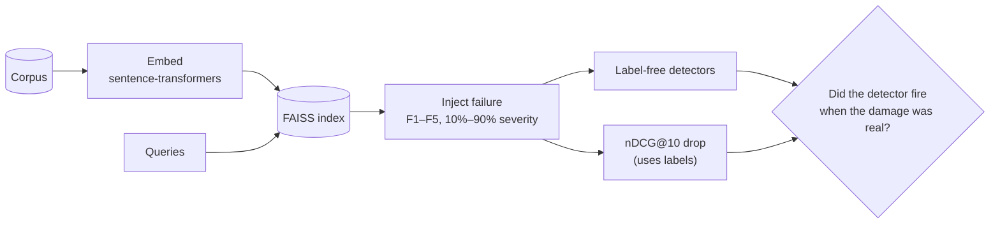

<div align="center">

# Silent Failures

**Detecting retrieval degradation in RAG systems without relevance labels**


[Motivation](#motivation) · [Approach](#approach) · [Failures](#failure-families) · [Detectors](#detectors) · [Evaluation](#evaluation) · [Early results](#early-results) · [Timeline](#timeline)

</div>

## Motivation

A RAG system embeds the user's question, finds the most similar documents in a vector index, and passes them to an LLM along with the question. If the retrieval step gets worse, nothing errors out. The system stays up and latency looks normal, but the answers get worse, and usually nobody notices for a while.

A few ways this happens in practice:

- an embedding model gets upgraded, but only part of the corpus is re-embedded
- outdated documents stay in the index next to their replacements
- chunking or preprocessing settings change partway through the corpus
- users start asking about things the corpus doesn't cover

Production systems don't have relevance labels, so you can't just track nDCG. Teams rely on label-free signals instead, like drift statistics or retrieval scores, and it isn't clear which of these actually catch real damage. That is the question this project tries to answer.

**What we plan to release**

1. An open-source benchmark that injects realistic retrieval failures at controlled severity
2. A detector-by-failure heatmap showing which signal catches what, and how early
3. A short, practical guide to monitoring retrieval quality

## Approach

We build a standard retrieval pipeline, break it in controlled ways, and check whether each detector notices. The detectors only get what a production system would have: queries, embeddings and similarity scores. The labeled relevance judgments are used for one thing only, measuring how much damage each failure actually caused.



## Failure families

Each failure is applied at increasing severity, from 10% up to 90% of the corpus or query traffic.

| ID | Failure | How we simulate it |
|---|---|---|
| F1 | Partial embedding upgrade | Mix vectors from two same-dimension models in one index |
| F2 | Stale documents | Outdated content from HoH, plus injected distractors |
| F3 | Chunking change | Re-chunk only part of the corpus |
| F4 | Query shift | Move query traffic toward topics outside the corpus |
| F5 | Config mismatch | Drop the query prefix, turn off vector normalization, etc. |

We also run **negative controls**: changes that move the data around without hurting retrieval. A good detector should stay quiet on these, so they tell us its false-alarm rate. Which ones we use is still being decided in [#9](https://github.com/Srikarmk/Silent-RAG-Failures/issues/9).

## Detectors

| Family | Detectors |
|---|---|
| Drift statistics (ML) | PSI, Kolmogorov–Smirnov test, MMD, domain classifier |
| Query performance prediction (IR) | Score-based signals, canary queries |
| Other | Re-embedding check, LLM-as-judge |

If there's time, we'll also test whether an agentic retriever that searches more than usual is itself a sign of hidden damage.

## Evaluation

The ground truth is the drop in **nDCG@10** from the clean baseline. Each check runs on a sampled window of queries, repeated over many trials per condition. A condition counts as harmful when its drop is significant under a paired bootstrap test.

Each detector is scored on:

- **Accuracy**: AUROC for separating harmful conditions from clean and harmless ones
- **Earliness**: the lowest severity at which it fires, at a 5% false-alarm rate
- **False alarms**: how often its default threshold fires on the harmless changes
- **Cost**: compute and API cost per check

We'll also report how big an nDCG@10 drop the common "PSI > 0.25" rule of thumb actually corresponds to.

### Datasets

| Dataset | Size | Used for |
|---|---:|---|
| NFCorpus | 3,633 medical documents | Development. All detector tuning happens here |
| SciFact | 5,183 scientific abstracts | Held-out evaluation |
| FiQA | 57,638 financial forum posts | Held-out evaluation |
| MLDR | long documents | Long-document behavior |
| HoH | real outdated content | Source for the stale-document failure (F2) |

SciFact and FiQA are never used for tuning, so the final numbers show how well the detectors generalize to data they haven't seen.

## Early results

Our first pass over SciFact is in [`notebooks/scifact_eda.ipynb`](notebooks/scifact_eda.ipynb), using `multi-qa-MiniLM-L6-cos-v1`.

| | Queries | Documents |
|---|---:|---:|
| Median length (tokens) | 21 | 316 |
| Max length (tokens) | 79 | 1,939 |
| Longer than 512 tokens (the model's hard limit) | 0 | 455 (8.8%) |
| Longer than ~250 tokens (what the model was trained on) | 0 | 3,793 (73.2%) |

Query length is not a concern. Document length is: most abstracts are longer than the inputs this model was trained on.

**Baseline.** We kept `multi-qa-MiniLM-L6-cos-v1` and embed title + text truncated at 256 tokens, with no chunking ([#5](https://github.com/Srikarmk/Silent-RAG-Failures/issues/5)). The goal is to evaluate detectors, not to get the best retriever. Clean nDCG@10 with exact cosine search in FAISS:

| Dataset | Test queries | nDCG@10 | 95% bootstrap CI |
|---|---:|---:|---|
| NFCorpus | 323 | 0.292 | 0.259–0.325 |
| SciFact | 300 | 0.546 | 0.496–0.595 |
| FiQA | 648 | 0.360 | 0.332–0.387 |

Truncating at 256 instead of 512 tokens made no significant difference on any of the three.

**Window size.** Each check scores a window of **100 queries** ([#4](https://github.com/Srikarmk/Silent-RAG-Failures/issues/4)). On NFCorpus, that's enough for the paired bootstrap to catch an nDCG@10 drop of about 0.06 in 80% of windows while staying under a 5% false-alarm rate. Windows of 25 or 50 queries only reliably catch drops of 0.10–0.13, and alarm more often than 5%. Both analyses are in [`experiments/baseline/window_size.py`](experiments/baseline/window_size.py).

## Timeline

We wrap up on **December 1**. Each milestone below has its issues on the [project board](https://github.com/users/Srikarmk/projects/2).

| Due | Milestone | Done when | Status |
|---|---|---|---|
| Oct 18 | [Baseline](https://github.com/Srikarmk/Silent-RAG-Failures/milestone/1) | Model and chunking fixed; clean nDCG@10 with CIs on SciFact, FiQA, NFCorpus | Done (#8 pending) |
| Oct 31 | [Failure injection](https://github.com/Srikarmk/Silent-RAG-Failures/milestone/2) | F1–F5 plus negative controls; nDCG@10 drops steadily with severity, negative controls don't | |
| Nov 11 | [Drift + QPP detectors](https://github.com/Srikarmk/Silent-RAG-Failures/milestone/3) | Implemented and tuned on NFCorpus | |
| Nov 18 | [Canary, re-embed, LLM judge](https://github.com/Srikarmk/Silent-RAG-Failures/milestone/4) | Implemented, with cost per check recorded for every detector | |
| Nov 24 | [Held-out evaluation](https://github.com/Srikarmk/Silent-RAG-Failures/milestone/5) | AUROC, earliness and false alarms on SciFact and FiQA; heatmap; PSI analysis | |
| Dec 1 | [Release](https://github.com/Srikarmk/Silent-RAG-Failures/milestone/6) | Benchmark, monitoring guide, final report (agentic extension only if there's time) | |

## Running it

**Setup** (Python 3.10 to 3.14; 3.15 has no scikit-learn wheels yet, so the install fails there)

```bash
git clone https://github.com/Srikarmk/Silent-RAG-Failures.git
cd Silent-RAG-Failures
python -m venv .venv && source .venv/bin/activate
pip install -e ".[dev]"
pytest
```

On Windows (PowerShell), activate with `.venv\Scripts\Activate.ps1` instead of `source .venv/bin/activate`. If PowerShell refuses to run the script, allow it for the current session first with `Set-ExecutionPolicy -Scope Process RemoteSigned`.

On a Mac, if anything that uses both faiss and torch exits with no error, prefix commands with `KMP_DUPLICATE_LIB_OK=TRUE OMP_NUM_THREADS=1`.

**Run**

```bash
python -m silent_rag.run --list                                # registered failures and detectors
python -m silent_rag.run --config configs/dev.yaml             # development run, NFCorpus only
python -m silent_rag.run --config configs/final.yaml --final   # held-out run, SciFact + FiQA
```

Both configs name `F1_partial_upgrade` and `ks_top1`, which don't exist yet (#8). Until they land the runner stops with `no injector registered for ...`; `--list` shows what is available.

Datasets (`nfcorpus`, `scifact`, `fiqa`) download from the Hugging Face Hub at pinned revisions. Corpus embeddings are cached under `cache/embeddings/` (or `$SILENT_RAG_CACHE/embeddings/`), keyed on the model, its revision, the settings that change the vectors and the corpus text itself, so only the first run of a setup embeds the corpus. The runner refuses SciFact and FiQA unless `--final` is passed.

**Output.** One parquet file, `results/<config name>.parquet` (or `--out`), with one row per dataset × failure × severity × trial × detector:

| Column | Meaning |
|---|---|
| `run_id` | hash of the config, so rows from different setups never mix |
| `dataset`, `model`, `model_revision` | what was run |
| `failure`, `severity`, `expected_harmful` | the condition; `clean` has severity 0, negative controls have `expected_harmful = False` |
| `seed`, `trial`, `window_size` | which query window was scored |
| `detector`, `score` | the detector's output, higher = more likely broken |
| `ndcg_drop`, `p_value`, `harmful` | ground truth: mean nDCG@k drop on the window, the one-sided paired bootstrap p-value, and `harmful = p_value < alpha and ndcg_drop >= min_drop` |
| `cost_s`, `cost_usd` | time per check, and API cost for the LLM judge |

**Config**

```yaml
datasets: [nfcorpus]
model: sentence-transformers/multi-qa-MiniLM-L6-cos-v1
retriever: {revision: <hub commit>}        # any Retriever argument: normalize, query_prefix, max_seq_length...
failures:
  F1_partial_upgrade: [0.1, 0.5, 0.9]      # registry name: severities (fraction affected, in (0, 1])
detectors: [ks_top1, re_embed]
window_size: 100
trials: 20
seed: 0
# optional, with defaults: k: 10, alpha: 0.05, min_drop: 0.0
# seeds: [0, 1, 2] instead of seed repeats the whole run (windows, reference window, damage) under one run_id
```

Detectors that take parameters are listed as `{name: {param: value}}`, e.g. `- re_embed: {sample: 50, metric: l2}`. `re_embed` treats per-doc distances below a noise floor as 0 (`floor`, default 1e-5 for cosine and 5e-3 for l2), so a clean index scores exactly 0 and thresholds should be above 0. One setting per detector per run; use two runs to compare settings.

**Adding a failure.** Put a module in `src/silent_rag/inject/`, subclass `Injector` and register it. The `name` is what the config and the results table use.

```python
import dataclasses
from silent_rag.inject.base import Injector, register

@register
class MyFailure(Injector):
    name = "F9_my_failure"
    harmful = True  # False for a negative control

    def apply(self, state, severity, seed):
        emb = state.doc_embeddings.copy()   # never modify state in place
        ...                                 # damage a `severity` fraction, deterministically from `seed`
        return dataclasses.replace(state, doc_embeddings=emb)
```

Keep query positions fixed. If the failure changes `query_texts`, set `query_embeddings=None` so the runner re-embeds them with the clean model; if it changes how queries are encoded, edit `query_embeddings` yourself (`state.config` is descriptive, nothing reads it to re-encode). The index and query arrays are read-only during a run, so copy before changing them. With chunking, set `parent_ids` and keep `doc_ids`, `doc_texts` and `doc_embeddings` row-aligned.

The runner makes one injector per failure and calls `attach(retriever)` on it once, then reuses it for every severity and trial. Put expensive setup there (a second model's embeddings for the whole corpus, a re-chunked corpus) and pick rows per trial in `apply`, rather than re-embedding inside every trial.

**Adding a detector.** Same pattern in `src/silent_rag/detect/`:

```python
from silent_rag.detect.base import Detector, register

@register
class MyDetector(Detector):
    name = "my_detector"

    def fit(self, reference):   # Observation from the clean system
        self.ref = reference.topk_scores[:, 0].mean()

    def score(self, window):    # Observation that may be damaged; higher = more likely broken
        return float(self.ref - window.topk_scores[:, 0].mean())
```

An `Observation` holds what a production system could log (query ids, texts and embeddings, top-k ids and scores, the index rows with their ids and texts) and deliberately no qrels. Treat it as read-only. A detector that needs to re-embed overrides `attach(retriever)`, which gets the clean retriever once before `fit()`. New modules in `inject/` and `detect/` are picked up automatically.

## Repository

```text
src/silent_rag/
  types.py            Dataset, RetrievalState, Observation (no labels)
  data.py             BEIR loaders, pinned revisions
  pipeline.py         embed, cache, index, search
  inject/             failure injectors (F1-F5, H1-H3)
  detect/             label-free detectors
  eval/               ground truth (nDCG drop, bootstrap), window-size analysis, results table
  run.py              experiment runner
configs/              dev.yaml (NFCorpus), final.yaml (held-out)
experiments/          one-off analyses (baseline CIs, window size, truncation)
notebooks/            exploration only
site/                 project page (Next.js static export), deployed to GitHub Pages on push to main
tests/
```

See [CONTRIBUTING.md](CONTRIBUTING.md) for how we're working.

**Stack:** sentence-transformers, FAISS, scikit-learn, SciPy, DuckDB, matplotlib

## Team

Kameswara Sai Srikar Manda, Alekhya Bulusu, Shane Hussey, Ying-Jen Chiang

DS5500 Capstone, Fall 2026, Northeastern University

## References

1. Lewis et al. [Retrieval-Augmented Generation for Knowledge-Intensive NLP Tasks](https://arxiv.org/abs/2005.11401). 2020.
2. Thakur et al. [BEIR: A Heterogeneous Benchmark for Zero-shot Evaluation of Information Retrieval Models](https://arxiv.org/abs/2104.08663). 2021.
3. Chen et al. [M3-Embedding](https://arxiv.org/abs/2402.03216) (source of MLDR). 2024.
4. Ouyang et al. [HoH: A Dynamic Benchmark for Evaluating the Impact of Outdated Information on RAG](https://arxiv.org/abs/2503.04800). 2025.
5. Zheng et al. [Revisiting RAG Retrievers: An Information Theoretic Benchmark](https://arxiv.org/abs/2602.21553). 2026.
6. Garani. [A Systematic Taxonomy of Failure Modes in Retrieval-Augmented Generation Systems](https://aclanthology.org/2026.trustnlp-main.27/). TrustNLP 2026.
7. Reimers and Gurevych. [Sentence-BERT](https://arxiv.org/abs/1908.10084). EMNLP 2019.
