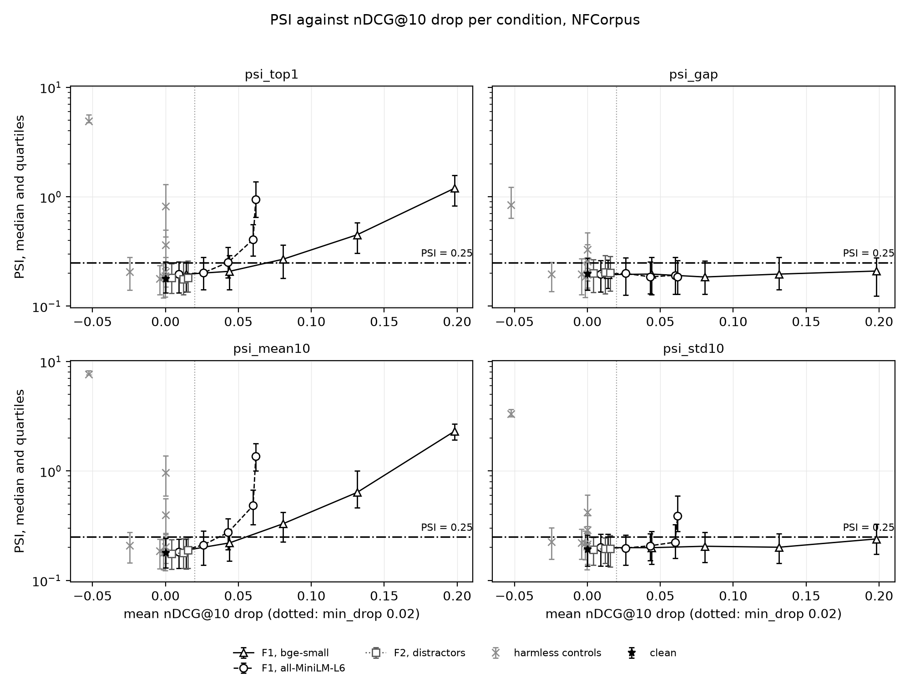
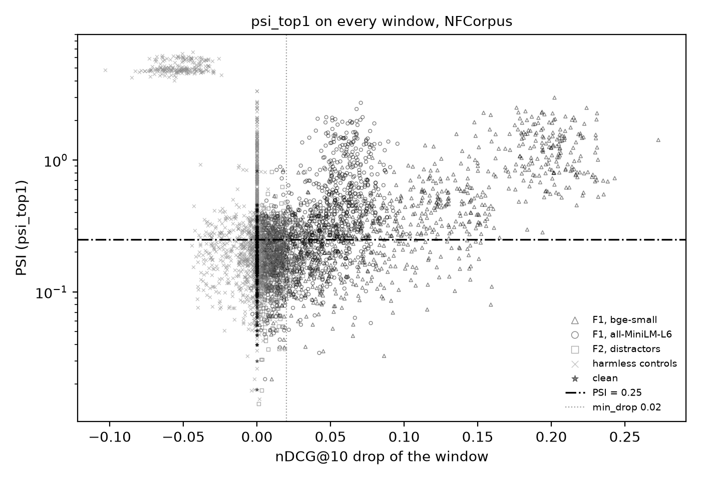

# What does PSI = 0.25 actually mean? (#31)

Dev only. NFCorpus, no SciFact or FiQA.

The rule of thumb says PSI > 0.25 is significant drift. This checks what nDCG@10 drop it
lines up with, per failure, using the PSI detectors as they are (`psi_top1`, `psi_gap`,
`psi_mean10`, `psi_std10`: ten quantile bins fit on the reference window, #19).

**Ground truth.** A window is harmful when its bootstrap p-value for the nDCG@10 drop is
below 0.05 and the drop is at least 0.02 (`min_drop`, #52). `analyze.py` recomputes it from
`p_value` and `ndcg_drop`, so it reads a run stored at another `min_drop` the same way.

**Conditions** (`psi_check.yaml`): clean windows; F1 with all-MiniLM-L6 and bge-small at
0.1 / 0.3 / 0.5 / 0.7 / 0.9; F2 distractors at 0.1 / 0.5 / 0.9; the negative controls
(mixed truncation 0.1 / 0.5 / 0.9, full swaps to all-MiniLM and bge, topic shift
0.1 / 0.5 / 0.9). Seeds 0–9, 20 windows of 100 queries per condition and seed, run_id
`9ac3ec042c9f`.

## Reproduce

From the repository root:

```bash
python -m silent_rag.run --config experiments/psi_rule/psi_check.yaml --out results/psi_rule/psi_check.parquet
python experiments/psi_rule/analyze.py
```

- About 10 minutes on a laptop CPU with the embedding cache warm (F1, ArguAna and the
  512-token corpus are encoded the first time)
- `analyze.py` writes `summary.txt`, `conditions.csv`, `crossing.csv` and the two figures
  into `results/psi_rule/psi_check_psi_rule/`. `--results results/dev_full.parquet` runs it
  on the full dev run (#79), which adds two more F1 partners
- The figures here are copies from run `9ac3ec042c9f`. They use greys, markers and line
  styles only, so they print in black and white

## Findings



Each point is one condition: the median PSI over its 200 windows (bars: quartiles) against
its mean nDCG@10 drop. The dash-dotted line is 0.25, the dotted one `min_drop` 0.02.

### Too jumpy: it fires with nothing wrong

| | `psi_top1` | `psi_gap` | `psi_mean10` | `psi_std10` |
|---|---|---|---|---|
| Median PSI on clean windows | 0.179 | 0.197 | 0.180 | 0.193 |
| Clean windows over 0.25 | 26% | 32% | 22% | 31% |
| Clean 95th percentile (#23) | 0.359 | 0.372 | 0.399 | 0.354 |
| Topic shift 0.5, windows over 0.25 | 70% | 53% | 77% | 64% |
| Full swap to bge, windows over 0.25 | 100% | 100% | 100% | 100% |

PSI is biased upward with small samples. With 100 reference and 100 window queries and ten
bins, two samples of the same distribution give ~0.19 on average (#63), so a quarter of clean
windows cross 0.25 before anything has changed. A threshold set on clean windows for 5% false
alarms sits at 0.35–0.40 instead.

### Too slow: real damage has to be large first

The nDCG@10 drop at which the median window crosses 0.25 (`crossing.csv`):

| | F1, bge-small | F1, all-MiniLM-L6 | F2, distractors |
|---|---|---|---|
| `psi_top1` | 0.069 (severity 0.3–0.5) | 0.042 (0.3–0.5) | never (median ≤ 0.18) |
| `psi_mean10` | 0.054 (0.3–0.5) | 0.036 (0.3–0.5) | never (≤ 0.19) |
| `psi_std10` | never (≤ 0.24, drop 0.20) | 0.060 (0.7–0.9) | never (≤ 0.20) |
| `psi_gap` | never (≤ 0.21, drop 0.20) | never (≤ 0.20) | never (≤ 0.20) |

- By F1 at severity 0.3, 71% (all-MiniLM) and 99% (bge) of windows are already harmful, but
  `psi_top1` and `psi_mean10` flag only 37–39% of those harmful windows, barely more than the
  22–26% of clean windows they flag
- `psi_gap` doesn't move with F1 at any severity, and `psi_std10` only at all-MiniLM 0.9
- On F2 (drops up to 0.016, harmful in 24% of windows at 0.9) no feature's median moves
  off its clean level



Every window of `psi_top1`: harm and PSI are only loosely related. Harmful F1 windows sit on
both sides of 0.25, and the bge full swap, which improves retrieval, is the highest PSI in
the run.

## For the monitoring guide

> **PSI > 0.25 is both too jumpy and too slow at a window of 100 queries.** Its small-sample
> bias alone puts a typical clean window at ~0.19, so 22–32% of clean windows cross 0.25, and
> harmless changes cross it more often (53–77% of windows when traffic shifts toward one
> topic, every window after a full swap to a model with a different score scale). Real damage,
> meanwhile, has to be large before PSI notices: on the top-1 and mean top-10 scores the median
> window only crosses 0.25 at an nDCG@10 drop of 0.04–0.07, when most windows are already
> harmful, and on the top-1/top-2 gap and the spread of the top 10 it barely moves at all.
> Distractor documents (F2) don't move PSI on any feature. If you use PSI, compute it on a
> level feature (top-1 or mean top-10 score), set its threshold from your own clean windows at
> your window size (0.35–0.40 here for 5% false alarms, #23), and read an alarm as "the scores
> changed", not "retrieval got worse".
